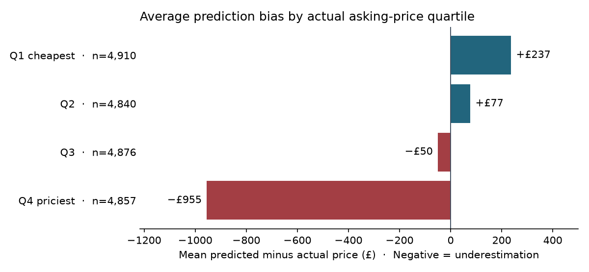

# UK Used-Car Listing Prices

[](https://github.com/agunggust/uk-used-car-price-prediction/actions/workflows/ci.yml)

**How could a dealer analyst use historical listing data to screen asking prices
for manual review?** This case study uses 97,411 listings from nine UK brands.
On a random holdout of 19,483 listings, XGBoost cut mean absolute error from
**£1,651 to £1,319 (20.1%)** versus Ridge. It still estimated prices in the
highest actual asking-price quartile **£955 too low on average**.



**Example review workflow.** A dealer analyst could route a listing estimated
at £28,000 with only six training examples of that brand and model to manual
review. Before setting an asking price, the reviewer would check recent
comparable listings, trim, and condition. An illustrative rule flags a
listing when its estimate is at least £25,000 or its brand and model have
fewer than ten training examples. The rule's impact on workload and
accuracy still needs testing on current listings.
The chart uses **actual** asking-price quartiles for historical diagnosis.
New-listing routing uses information available at prediction time.

[Exploratory analysis](notebooks/02_eda.ipynb) ·
[Model and error analysis](notebooks/05_analysis_interpretability.ipynb) ·
[Evaluation metrics](reports/model_metrics.json)

## Setup

Use Python 3.12 or later (the pinned dependencies require it), then install the
project dependencies:

```powershell
python -m venv .venv
.\.venv\Scripts\Activate.ps1
python -m pip install -r requirements.txt
```

The same suite runs on GitHub Actions via `.github/workflows/ci.yml` for every
push and pull request to `main`; CI installs `requirements.txt` and runs
`python -m pytest`. The test suite needs neither the raw dataset nor the saved
model files.

## Dataset

Download the [100,000 UK Used Car Data set from Kaggle](https://www.kaggle.com/datasets/adityadesai13/used-car-dataset-ford-and-mercedes)
and put these nine files in `data/raw/`:
`audi.csv`, `bmw.csv`, `ford.csv`, `hyundi.csv`, `merc.csv`, `skoda.csv`,
`toyota.csv`, `vauxhall.csv`, and `vw.csv`. The repository excludes the source CSVs.
`price` is the asking price in GBP, `tax` is annual tax in GBP, `mileage`
is in miles, `mpg` is in miles per gallon, `engineSize` is in litres, and
`year` is the vehicle model year.

Notebook 01 and `python -m src.data` use the same cleaning function. It
standardizes two model labels before deduplication, retaining the first
occurrence of identical rows because the dataset has no listing ID. It keeps
model years 1995–2020 to match the historical snapshot, removes non-electric
listings with zero engine size as likely missing data, and removes MPG below
10 as a suspected input or unit issue. Zero tax and high MPG can be valid
and are retained.

The notebook records input SHA-256 hashes and overlap checks in
[`reports/data_audit.json`](reports/data_audit.json). Optionally add
`cclass.csv` and `focus.csv` to audit matches against the Mercedes and Ford
files. The notebook records a skipped check for each absent file. These
subsets and the two `unclean` variants are excluded from the training input.
The audit also records the SHA-256 of the cleaned CSV so it can be matched
to the dataset identified in the model and evaluation reports.

## Reproduce the baseline and model selection

Run these commands from the repository root:

```powershell
python -m src.data
python -m src.train
python -m src.evaluate
python -m src.modeling
python -m src.analysis
```

The cleaning step writes `data/processed/cars_clean.csv`. Training uses the
fixed 80/20 split (random state 42), fits preprocessing only on the training
partition, and saves `models/03_ridge_baseline.joblib`. Evaluation reports MAE,
RMSE, and R² for the saved Ridge model and a median-price dummy on the same
holdout split. The model uses `car_age` relative to 2020, scaled numeric
features, one-hot encoded categorical features, and a log-transformed price
target.

The model-selection step compares three Ridge regularization strengths and
four XGBoost configurations using three-fold cross-validation on the training
split. It selects by cross-validated MAE, then evaluates the selected estimator,
the step-03 Ridge baseline, and the median dummy on the holdout set. The test
metrics do not affect model selection. Outputs are saved to
`models/04_best_model.joblib`, `reports/modeling_cv_results.csv`, and
`reports/model_metrics.json`. Import the saved estimator and call `.predict()`
with a DataFrame containing the input columns from `cars_clean.csv` except
`price`; preprocessing is included in the estimator.

Each saved model records the SHA-256 of the exact cleaned CSV and the hashes
of the ordered training and holdout row positions, alongside the split seed
and sizes. It also records the Git HEAD at fit time, hashes of the Python
source files used in that checkout, and the Python and modeling dependency
versions. Source hashes capture local edits when training happens before
they are committed. The cleaning command writes LF line endings so the
CSV hash does not change solely because of the operating system.

`src.evaluate`, `src.modeling`, and `src.analysis` check the dataset and
split before scoring saved models. If a model has missing or mismatched
provenance, use the original cleaned CSV or rerun the training commands
above. `model_metrics.json` and `analysis_summary.json` include the evaluated
model file SHA-256 and its training provenance. Prediction still accepts
the fitted estimator directly.

To customize file locations, use `--data-dir` and `--output` with
`python -m src.data`, or `--data` and `--model` with `src.train` and
`src.evaluate`. The model-selection command also accepts `--baseline-model`,
`--reports-dir`, and `--cv`.

## Analyze the model

`python -m src.analysis` scores the same holdout split as `src.modeling` and
writes CSV reports, a JSON summary, and five figures:

| Output | Contents |
|---|---|
| `reports/feature_importance_top.csv` | 20 most important encoded features |
| `reports/feature_importance_by_source.csv` | impurity importance summed per source column |
| `reports/feature_importance_permutation.csv` | MAE increase when each source column is shuffled |
| `reports/error_by_{brand,transmission,fuelType}.csv` | MAE, median error, and bias per category |
| `reports/error_by_price_band.csv` / `error_by_age.csv` | error across price quartiles and age bands |
| `reports/worst_predictions.csv` | the 20 largest holdout misses |
| `reports/analysis_summary.json` | headline metrics, accuracy bands, both importance views |
| `reports/figures/analysis_*.png` | importance bars and comparison, residual scatter, MAE by brand, and bias by actual price quartile |

Impurity importance is read from the fitted XGBoost booster and the encoded
names come from the fitted `ColumnTransformer`, so one-hot categories are
collapsed back onto their source column. Because impurity importance is biased
towards columns with many split points (`model` has 194 distinct values), the
command also runs permutation importance — shuffling each source column through
the full pipeline and measuring how much MAE worsens. The command accepts
`--data`, `--model`, and `--reports-dir`.

## Stress checks on the historical holdout

Run `python -m src.robustness` after model selection to regenerate
[`reports/robustness_summary.json`](reports/robustness_summary.json). A
comparable-listing baseline uses the first training median available at
`brand/model/age band`, `brand/model`, or `brand`, requiring at least 10
training listings at each level. It falls back to the overall training
median. The age bands are 0–1, 2–3, 4–5, 6–8, 9–11, and 12+ years.

On the same 19,483 listings, XGBoost has MAE **£1,319** versus **£2,388**
for the comparable-listing baseline. Model support counts are based on
training listings with the same brand and model:

| Training support | Holdout listings | XGBoost MAE | XGBoost bias |
|---|---:|---:|---:|
| Common (10+) | 19,440 | £1,310 | −£162 |
| Rare (1–9) | 38 | £6,001 | −£4,833 |
| Unseen (0) | 5 | £2,497 | −£1,622 |

About 66.3% of holdout listings share a brand, model, year, transmission,
fuel type, engine size, and 1,000-mile bin with at least one training
listing. MAE is £1,242 with a match and £1,472 without one. Matching
specifications do not establish that listings describe the same vehicle.
These are comparisons within a historical snapshot. The rare and unseen
groups are small, and the dataset provides no listing dates or newer
snapshot for temporal validation.

## Findings

Numbers below come from the holdout split (19,483 listings) and can be
regenerated with `python -m src.analysis`.

**Overall accuracy.** MAE is the mean absolute difference between predicted
and actual asking price (£1,319). RMSE gives more weight to large misses
(£2,295), and R² is 0.948. Median absolute percentage error is 6.2%.
Of all holdout predictions, 71.1% fall within ±10% and 97.7% within ±25%.
Mean bias (predicted minus actual asking price) is −£172.

**Error grows with price.** MAE rises from £618 in the cheapest quartile to
£2,464 in the priciest. MAE divided by the segment median asking price
rises from 7.7% to 9.2%. Each quartile contains roughly a quarter of the
holdout, and the overall MAE obscures the larger premium-segment misses.

**New cars are the hardest.** The 0–1 year band has the highest MAE (£1,890)
versus £931 for 6–8 year cars. Missing trim and options are possible
explanations that this dataset cannot verify.

**Brands.** Mercedes (£2,104), BMW (£1,880) and Audi (£1,815) have the largest
absolute errors because their cars cost more, but on a relative basis they sit
near the pack (9.1–9.4%); Vauxhall is easiest at £756 (7.6%).

**The two importance views disagree.** Impurity importance ranks `model` at
51% and `transmission` at 24% while `mileage` shows 0.4%. Permutation
importance — which shuffles each source column through the whole pipeline —
tells a different story: `engineSize` (+£2,448 MAE), `year` (+£2,152),
`brand` (+£1,155) and `mileage` (+£949) matter most, while `model` adds only
£871 and `tax` £57. The impurity numbers are inflated by `model` having 194
distinct values, so use `reports/feature_importance_permutation.csv` when
deciding which data to collect next.

**Largest misses need review.** The worst miss is a 2011 Mercedes SL listed
at £149,948 with a prediction of about £21,345. Three of the five largest
misses are Mercedes G-Class listings. Check the original listing and
comparable vehicles before deciding whether to correct the data.

**Do not read into tiny segments.** `Electric` and transmission `Other` have
two listings each in the holdout, so their reported errors are noise.

**Limitations.** The dataset is asking prices collected around 2020 and the
split is random rather than time-based, so the model is not validated on later
market conditions. There is no trim, condition, or damage history, and the
model returns a point estimate with no uncertainty band.

## Predict prices

`src.predict` scores new listings with the saved model. Pass a CSV with the same
input columns as `cars_clean.csv` minus `price`:

```powershell
python -m src.predict --input listings.csv --output predictions.csv
```

Or score a single car with flags:

```powershell
python -m src.predict --year 2019 --mileage 20000 --tax 145 --mpg 55.4 `
  --engine-size 1.4 --brand audi --model-name A1 --transmission Manual --fuel-type Petrol
```

Predictions are written to a `predicted_price` column. Missing or non-numeric
inputs raise an error instead of being silently imputed, and the command uses
`models/04_best_model.joblib` unless `--model` points elsewhere. If the input
CSV still contains `price`, the command also prints MAE, RMSE, and R² for that
batch.

## REST API

`src.api` serves the saved model over HTTP:

```powershell
python -m src.api
```

Then open `http://127.0.0.1:8000/docs` for the generated interactive docs.
Endpoints:

- `GET /health` — reports whether the model file is present.
- `POST /predict` — one car, returns `predicted_price` in pounds.
- `POST /predict/batch` — a JSON array of cars, returns predictions in input order.

```powershell
$body = @{
  year = 2019; mileage = 20000; tax = 145; mpg = 55.4; engineSize = 1.4
  brand = "audi"; model = "A1"; transmission = "Manual"; fuelType = "Petrol"
} | ConvertTo-Json

Invoke-RestMethod -Uri http://127.0.0.1:8000/predict -Method Post `
  -ContentType "application/json" -Body $body
```

The CLI and API apply the same value rules. Numeric fields must be finite.
The model year must be a whole number from 1995 through 2020, mileage and tax
must be non-negative, and MPG must be positive. Engine size must be positive
except that `Electric` listings may use zero. Text is trimmed and must be
non-empty. Unseen categories are accepted and handled by the model's encoder.
Invalid API payloads return HTTP 422. If the model file is missing the
endpoint returns HTTP 503 while `GET /health` still answers. To point the app
at a different model, call `create_app(model_path)` from `src.api` in your own
script.

The server binds to `127.0.0.1:8000` by default; override it with `--host` and
`--port`.

## Docker

The API ships with a Dockerfile that installs only the serving dependencies
from `requirements-api.txt` (a pinned subset of `requirements.txt`, checked for
drift by `tests/test_requirements.py`):

```powershell
docker build -t used-car-price .
docker run --rm -p 8000:8000 used-car-price
```

Then `http://127.0.0.1:8000/docs` is the same API as `python -m src.api`. The
image contains `src/` and `models/04_best_model.joblib` only — no dataset,
notebooks, or reports — and declares a `HEALTHCHECK` against `GET /health`.
CI builds the image and smoke-tests a running container on every push.

## Tests

The test suite uses pytest and does not need the raw dataset or trained model
artifacts — it builds small synthetic frames and fits the pipeline on them:

```powershell
python -m pytest
```

It covers cleaning rules, feature engineering, the deterministic split, the
baseline pipeline, prediction-side input validation, model loading, feature
importance and error analysis, the API contracts (including rejection of
invalid payloads), and the API dependency pins.

## Notebooks

Run the notebooks in order from `notebooks/`: `01_data_audit_eda.ipynb`,
`02_eda.ipynb`, `03_preprocessing_features.ipynb`,
`04_modeling_evaluation.ipynb`, and `05_analysis_interpretability.ipynb`.
Set the notebook working directory to `notebooks/` as their relative paths
expect. The cleaning notebook produces the processed CSV required by the
remaining notebooks.

Notebook 05 reads the model chosen in notebook 04 and regenerates the analysis
reports in `reports/` through `src.analysis`; it does not retune anything on
the test set.
